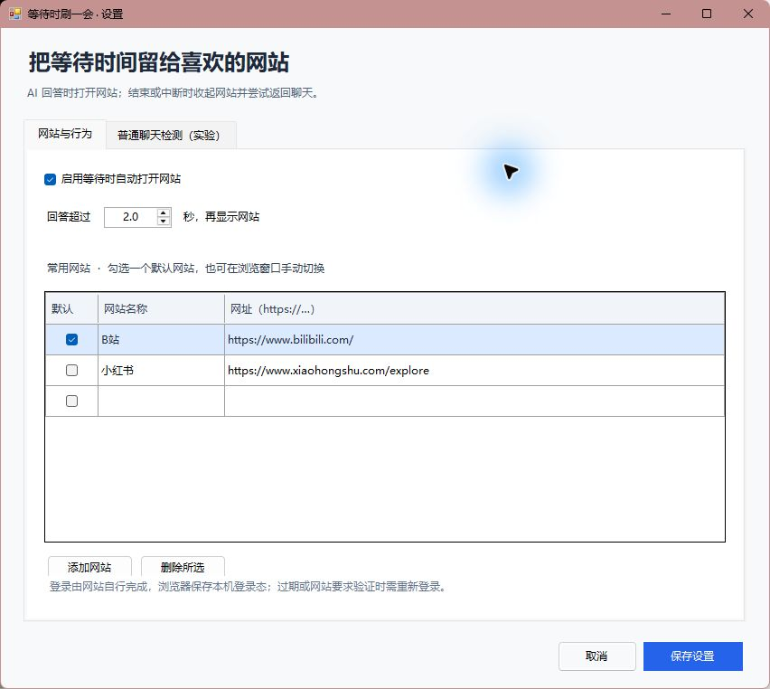

# GPT Wait Break · 等待时刷一会

给 Windows 上的 GPT 桌面工作流加一个小休息：发送消息后，AI 如果仍在处理，显示你选择的网站；回答准备结束、主动中断或需要批准操作时，收起网站并尝试回到聊天。

这是 **本地 GPT 插件 + Windows 托盘伴侣**，网站在配套的独立 WebView2 窗口中打开。你可以自定义 HTTP/HTTPS 网址并自行登录；浏览器配置保存在本机，后续尽量复用登录和浏览位置。它不使用 OpenAI API key，也不额外调用模型。

> **0.1.0 预览版**：本地 Work/Codex 接入官方 hooks。普通 ChatGPT 聊天仅提供默认关闭的实验性无障碍检测，不能承诺所有版本都能自动检测。这个项目不控制 GPT 内置浏览器，也不是已经进入公共插件目录的官方插件。

## 能做什么

- 常用网站列表、默认网站和弹出延迟，可在中文设置界面编辑。
- 复用网站标签和本地浏览器配置，不必每轮重新加载页面。
- `UserPromptSubmit` 开始计时，短回答在延迟内完成就不弹出网站。
- `Stop`、`Interrupt`、`PermissionRequest`、`SessionEnd` 驱动返回逻辑。
- 网站窗口提供手动返回；托盘可打开网站、设置、暂停或退出。
- 收起时尽力暂停网页媒体并静音，Windows 不允许自动聚焦时用任务栏提示兜底。

| 使用场景 | 接入方式 | 状态 |
| --- | --- | --- |
| Windows 上本地 Work / Codex | 用户审核并信任的插件 hooks | 主要支持路径，具体桌面版本仍需实机验收 |
| 普通 ChatGPT 桌面聊天 | 可选 UI Automation 控件状态检测 | 实验性；遮挡、最小化或控件变化可能无法判断 |
| 云端编排 Work / 网页 / 手机 | 本发行包没有可用本地事件接入 | 不支持自动切换 |
| 自定义网站登录 | 独立 WebView2 配置 | 由网站决定兼容性和会话有效期 |

## 快速开始

需要 Windows 10/11 x64、.NET Framework 4.8、[Microsoft Edge WebView2 Evergreen Runtime](https://developer.microsoft.com/microsoft-edge/webview2/)，以及支持本地插件 hooks 的 GPT/Codex 桌面客户端。普通聊天的实验模式可以独立运行，不依赖插件事件。

1. 下载 GitHub Release 中的 `gpt-wait-break-<版本>-win-x64.zip`，解压到本地文件夹。GitHub 的 **Code → Download ZIP** 是源码包，须先按下文构建。
2. 查看脚本和 hooks 后，在解压目录打开 PowerShell。若 Codex CLI 已在 PATH 中，执行：

   ```powershell
   .\Install.ps1 -RegisterPlugin -Start
   ```

   没有 CLI 时先执行 `.\Install.ps1 -Start`，再按[安装指南](docs/INSTALL.md)用桌面插件目录添加本地源。
3. 重启 GPT/Codex 桌面端，在插件目录中确认 **GPT Wait Break** 已启用。按客户端的官方流程审核并信任当前 hooks；安装脚本不会替你信任它们。
4. 在配套设置界面添加自己的网址、选择默认网站和等待时间。普通聊天只有手动勾选“实验性无障碍检测”后才会被观察。
5. 从托盘打开网站，自行登录。发送一条需要较长时间处理的消息，验收弹出、结束返回和中断返回。

安装路径是 `%LOCALAPPDATA%\Programs\GptWaitBreak`。默认不设置开机启动；需要时运行 `.\Install.ps1 -Startup`。登录与设置数据在 `%LOCALAPPDATA%\GptWaitBreak`，与程序目录分开。

如果 Windows PowerShell 阻止脚本运行，先检查下载来源和脚本内容，再按照你所在设备的脚本执行策略操作；也可直接运行 `bin\GptWaitBreak.exe --configure` 并采用手动插件安装。项目不会关闭系统执行策略或绕过 hooks 审核。

## 日常使用



默认等待约 2 秒后打开网站。首次打开某个网站可能还需要初始化 WebView2。网站工具栏可切换常用网站、打开设置或返回聊天；关闭网站窗口会收起页面，退出程序请使用托盘菜单。

AI 回答准备结束时会收到 `Stop`。其他 hooks 可能让 AI 继续运行，因此程序会短暂去抖并处理再次开始；这不等同于一个保证绝对最终完成的官方事件。多聊天窗口、同时进行多条任务和 Windows 焦点限制可能需要手动返回。

第一次登录由你在网站里完成。Cookie、网站本地存储等由 WebView2 配置保存，不继承 Chrome、Edge 或 GPT 内置浏览器的账号。网站退出登录、会话过期、风控、扫码/验证码或不支持嵌入式浏览器时，需要按网站要求处理；不能保证“小红书、B站、抖音、微博、X 等全部登录正常”。

详细说明：[安装与更新](docs/INSTALL.md) · [使用方法](docs/USAGE.md) · [隐私与数据](docs/PRIVACY.md) · [故障排查](docs/TROUBLESHOOTING.md) · [架构与开发](docs/ARCHITECTURE.md)

## 源码构建

使用 Windows 自带的 .NET Framework x64 C# 编译器，不需要 Visual Studio 或 `dotnet` SDK。

```powershell
.\scripts\build.ps1
.\tests\run.ps1 -SkipBuild
.\scripts\package.ps1 -SkipBuild
```

首次构建从 NuGet 下载固定版本 WebView2 SDK，并验证 SHA256。依赖锁定在 `scripts/dependencies.json`，有缓存后可用 `.\scripts\build.ps1 -Offline`。包输出到 `dist/`，程序输出到 `bin/`；两者和浏览器数据均不提交 Git。打包时会再次运行默认测试。可选浏览器集成测试见[开发文档](docs/ARCHITECTURE.md)。

## 验证状态

2026-10-15 在 Windows x64 上验证：

- C# 5 / .NET Framework 构建通过；101 项状态机、按钮分类、配置、隐私处理和 IPC 检查通过。
- 发行包使用的 PowerShell hook 命令实际转发到隔离 IPC 接收器，输出为干净的 `{}`，没有转发提示词或回答正文。
- 隔离 localhost 浏览器测试通过：标签和网页复用、收起最小化与静音、弹窗共享会话与保留 opener、退出后由第二个进程恢复持久 Cookie。
- 隔离 Codex 配置中的 marketplace 注册、插件安装与启用列表查询通过；没有修改使用者配置或代为信任 hooks。
- 中文设置界面完成可视检查，安装包排除测试配置、浏览器档案和缓存。

真实 GPT 桌面客户端插件安装/信任流程、普通聊天后台检测、各社媒账号登录和 Windows 聚焦行为，必须在使用者的实际环境中验收；模拟事件与本地测试不能替代这些测试。

## 原理与分发限制

插件打包 skill、hooks 和配套程序，skill 用于设置与故障排查，自动弹出/返回由本地事件和程序完成。官方目前将带生命周期 hooks 的插件限定为手动安装的 Codex desktop 插件，这类插件不能提交公共插件目录；因此此项目通过 GitHub Release 和本地 marketplace 分发。[官方插件打包说明](https://developers.openai.com/plugins/build/plugins)

本地 Work/Codex hooks 的事件、信任要求和云端限制以[官方 Hooks 文档](https://learn.chatgpt.com/docs/hooks)为准。CLI 注册命令见[官方 CLI 参考](https://learn.chatgpt.com/docs/cli/reference)。文档核对日期：2026-10-15。

MIT © 2026 Osphey。Microsoft WebView2 的许可随包附带，见[第三方说明](THIRD-PARTY-NOTICES.md)。
