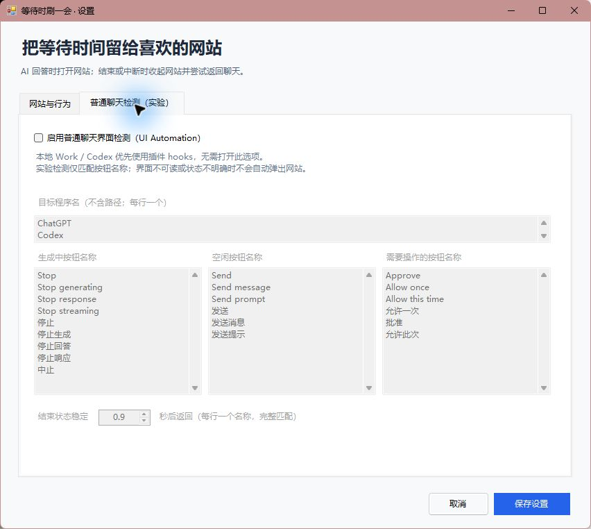

# 使用方法

## 配置网站

从开始菜单启动 GPT Wait Break，双击托盘图标，或选择“设置网站与检测”。在网站列表编辑名称和完整的 HTTP/HTTPS 网址，勾选一个默认网站，再保存。地址不得带 `用户名:密码@`，不支持 `file:`、`javascript:` 等协议。默认是 B站和小红书示例，可全部换成自己的网址。

“回答超过 … 秒，再显示网站”决定弹出延迟，默认 2 秒；“结束状态稳定 … 秒后返回”用于避免重复结束事件造成闪烁，默认约 0.9 秒。保存设置会收起旧网站窗口并重建它；登录配置仍保留。

选择托盘“打开网站 / 登录”，在浏览窗口自行登录。工具栏提供网站选择、地址栏、前进后退、刷新、设置和返回聊天。登录弹窗在同一个浏览器环境中新建标签，网站也可能要求外部浏览器、手机扫码或重新验证。

快捷键：`Ctrl+L` 聚焦地址栏，`Ctrl+R` 刷新，`Ctrl+W` 关闭当前标签，`Alt+←/→` 前进后退。地址栏未聚焦时，`Escape` 可返回聊天。顶层导航及弹窗只允许 HTTP/HTTPS；唤起其他应用的链接被阻止，因此部分“跳到手机/客户端登录”的流程不可用。

## 等待和返回

在支持的本地 Work/Codex 聊天中提交消息后，hook 发送事件给托盘程序；程序没启动时，开始事件可自动启动它。延迟到达且你仍在对应聊天窗口时才显示网站。如果已经转去其他应用，程序不会为了开始浏览把它盖住。

准备结束、主动中断、权限请求或会话结束时，程序收起自己的窗口。如果你仍在这个网站窗口中，会尝试聚焦原来的 GPT 窗口；如果你已经转到其他应用，只闪烁 GPT 任务栏图标，避免打断你。Windows 可能拒绝聚焦，此时请手动点回 GPT。

“返回聊天”也可以手动收起网站。普通聊天实验模式在返回后会等到明确空闲状态才重新启用，避免同一条回答仍在生成时再次弹出。只有先前识别到目标 GPT 窗口时才有可靠的返回目标；通过开始菜单单独打开网站、尚未识别到聊天窗口时，手动返回只能收起网站。多个窗口或后台任务不会保证定位到某个具体聊天页。

收起时会尽力暂停页面中正在播放的 `<video>` / `<audio>` 并将浏览器静音，重新显示时尝试恢复；跨域 iframe 或网站自定义播放器的行为可能不同。页面不会因每轮等待而全部重新导航，但退出程序后，下一次启动会重新加载配置网址，不能保证恢复上次滚动位置或视频进度。

## 普通 ChatGPT 聊天：实验模式

1. 启动托盘程序，打开“设置网站与检测”的实验检测页面。
2. 勾选“启用普通聊天界面检测（UI Automation）”。
3. 保持真实的 ChatGPT 桌面窗口在前台发送消息，验收是否检测到生成。
4. 如果 UI Automation 没有得到可靠状态，程序保持 Unknown，不把“看不到停止按钮”当作回答完成。

默认观察 `ChatGPT`、`Codex` 进程名，以及完整匹配的“停止生成”“发送消息”等按钮名称。界面语言或版本变化时可以修改这些名称；名称必须与应用通过无障碍接口暴露的按钮文字一致。把过于通用或错误的文字加入列表会产生误判。

被网站遮挡后，控件是否仍可访问取决于 GPT 的实现；最小化、控件离屏或接口不可用可能导致无法自动返回。需要操作时用网站上的“返回聊天”兜底。此模式没有官方普通聊天生命周期事件，不作为稳定兼容承诺。

## 登录和数据

浏览器使用 `%LOCALAPPDATA%\GptWaitBreak\BrowserProfile`。首次登录后，网站可将 Cookie 和本地存储保留在这里。重启程序后可能继续登录；网站会话到期、主动退出、清理数据或风控后，需要再次登录。

本程序不保存一份密码表，不代填验证码，也不导入其他浏览器的 Cookie。请直接在网站页面处理账号操作。详细数据说明见 [PRIVACY.md](PRIVACY.md)。

## 暂停和退出

- 托盘“启用等待浏览”：取消勾选即暂停自动弹出。
- 网站窗口右上角关闭：收起窗口并保留运行中的浏览器实例。
- 托盘“退出”：退出程序。下次本地开始 hook 仍可再次启动它；要彻底停用自动启动，请同时在桌面端禁用插件。
- 开机启动：安装时显式传入 `-Startup`；关闭时删除当前用户“启动”文件夹中的 `GPT Wait Break.lnk`，卸载器也会删除它。
